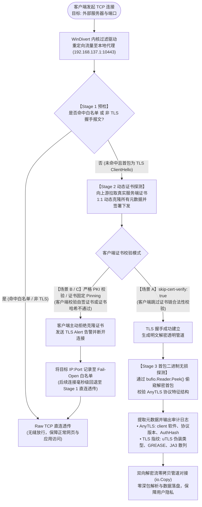
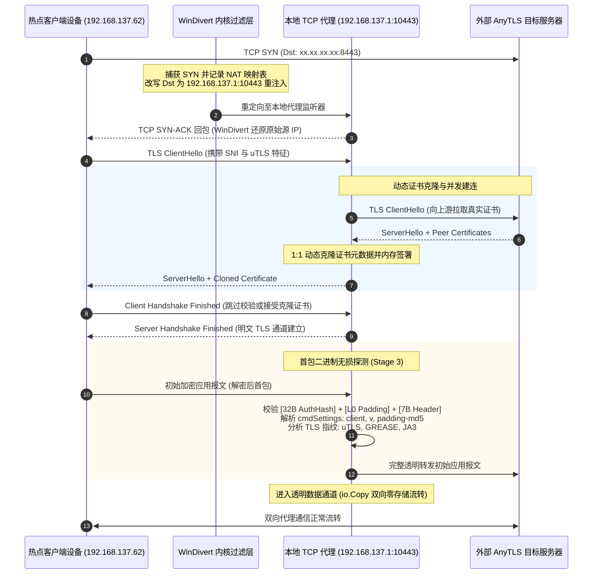

# Lightweight AnyTLS Transparent MITM Proxy for Windows Hotspot

本项目为基于 Windows 移动热点（Mobile Hotspot / 默认 ICS 网段 `192.168.137.0/24`）的高性能轻量级 AnyTLS 透明中间人（MITM）识别代理。所以在此建议所有使用 AnyTLS 的用户务必使用服务端证书，或者fingerprint校验。

---

## 1. 部署与配置场景 MITM 可行性核心原因分析

在对 AnyTLS 代理进行透明 MITM 劫持与协议识别前，必须从 TLS 密码学与客户端配置角度评估其可行性。下表总结了三种核心客户端配置场景下的 MITM 可行性及根本原因：

| 客户端配置场景 | MITM 可行性 | 核心成因分析 |
| :--- | :---: | :--- |
| **场景 A：开启 `skip-cert-verify: true`（且未配置指纹固定）** | **极高（完全可行）** | 客户端显式禁用了标准 X.509 PKI CA 证书链校验。本地代理向上游真实服务器握手拉取原始证书后，动态 **1:1 克隆所有元数据**（Subject、Issuer、DNS SAN、IPAddresses、有效期等）并签署下发给客户端，客户端校验宽容通过，完成 TLS 握手。代理从而获得明文管道探测 AnyTLS 首帧。 |
| **场景 B：标准 PKI 证书校验（默认安全配置，有效域名证书）** | **极低（不可行）** | 客户端严格依赖系统受信任的根证书颁发机构（如 Let's Encrypt、DigiCert 等）。由于代理无法获取公网权威 CA 的私钥，克隆证书属于自签名或非信任 CA 签署，客户端在握手阶段检测到非可信 CA 立即中断连接（返回 `tls: unknown certificate authority`），握手失败。 |
| **场景 C：配置了 `fingerprint` / 自定义 CA（证书固定 Pinning）** | **极低（不可行）** | 客户端（如 sing-box、mihomo 等）配置了证书指纹（SHA256 Pinning）或指定单独的根 CA 文件。客户端在握手期间会直接计算服务端证书的哈希值与预设指纹进行严格比对。即使操作系统信任代理证书，因公私钥对改变，证书哈希必然不匹配，客户端立即拒发后续数据并发送 TLS 警报。 |

### 客户端场景识别与决策链路



---

## 2. AnyTLS MITM 探测与拦截核心实现

本代理采用内核网络过滤 + 三阶段透明流水线架构，实现全端口 AnyTLS 识别与客户端特征探测。

### 2.1 整体架构拓扑



---

### 2.2 核心技术细节实现

#### 1. WinDivert 全端口透明拦截（`divert/redirector.go`）
- **全端口支持（`1-65535`）**：默认监听全端口。为了避免在 WinDivert 过滤表达式中拼接 65535 个 `or` 条件造成底层驱动缓冲区溢出（Filter Buffer Overflow），采用反向排除规则：
  ```c
  tcp.DstPort != 10443 and (ip.SrcAddr >= 192.168.137.2 and ip.SrcAddr <= 192.168.137.254)
  ```
- **双向 NAT 状态维护**：利用并发安全的 `NATTable` 将 `ClientIP:Port` 映射至原始目标 `OrigDstIP:Port`，确保应用层可无感知获取真实的远端目标服务地址。

#### 2. 三阶段识别流水线（`mitm/proxy.go`）
- **Stage 1 (Fail-Open 快速放行与白名单预检)**：
  - 检查内存白名单。若命中或首包非 TLS（第一个字节非 `0x16`），直接通过 Raw TCP 建立直连透传，绝不影响普通网页浏览。
- **Stage 2 (动态证书克隆与防误杀机制)**：
  - **1:1 动态证书克隆**：向上游建立 TLS 握手获取原始证书并 1:1 复制（Subject、Issuer、DNS SAN、IPAddresses 及有效期），并存入证书缓存实现毫秒级快速握手。
  - **精准白名单防误杀**：严格区分真正的**客户端证书警报拒绝**（如 `bad certificate`、`unknown certificate authority`）与**普通网络抖动/并发探测 RST（`wsarecv`）/连接超时**。只有确认为证书拒绝时才加入白名单，防止因客户端并发建连测速而误杀 AnyTLS 节点。
- **Stage 3 (无损二进制协议探测与指纹提取)**：
  - 利用 `bufio.Reader.Peek()` 偷窥解密后的首包流，匹配 AnyTLS 协议特征结构：
    ```text
    +------------------------------------+------------------+------------------+------------------+
    | SHA256(password) Hash (32 字节)    | Padding0 长度 L0 | Padding0 数据    | 7 字节帧头       |
    |                                    | (2 字节大端序)   | (L0 字节随机填充)| Cmd + StreamID   |
    +------------------------------------+------------------+------------------+------------------+
    ```
  - 校验首帧合法性：检查是否为合法命令字 `cmdSettings (4)`、`cmdWaste (0)` 或 `cmdSYN (1)`，且 StreamID 满足规范。

#### 3. 客户端 TLS 指纹与应用元数据探测
- **uTLS / GREASE / JA3 指纹识别（`mitm/fingerprint.go`）**：
  - 检测 RFC 8701 GREASE 保留值的注入情况。
  - 分析密码套件、椭圆曲线及 ALPN 顺序，分类客户端指纹模式（如 `uTLS (Chrome/Chromium/Edge 伪装)`、`uTLS (Safari/iOS 伪装)`、`uTLS (Firefox 伪装)`、标准 Go 客户端等）。
  - 提取 JA3 原始指纹特征并生成 JA3 MD5 散列。
- **内层应用元数据识别（`mitm/detector.go`）**：
  - 解析 `cmdSettings` 中的明文 UTF-8 配置信息，直接提取客户端应用名称（如 `sing-box 1.10.0`、`mihomo`）、协议版本（`v=1`）及 `padding-md5`。

#### 4. 零深包存储与隐私安全
- 识别命中后仅在控制台输出关键审计日志（包含客户端 IP、服务端 IP、SNI、AuthHash 及指纹元数据）。
- 数据流直接交接由两组轻量协程 `io.Copy` 进行双向透明转发，不落盘任何网络数据载荷。

---

## 3. 运行环境与依赖文件

### 3.1 依赖驱动文件
本工具依赖 **WinDivert**（建议 WinDivert 1.4.x 或 2.2.x 稳定版）。请确保将以下文件放置在编译后的可执行文件 `anytls-mitm.exe` **同级目录**下：

- `WinDivert.dll`（64 位 DLL）
- `WinDivert64.sys`（64 位 Windows 系统内核驱动）
- `WinDivert32.sys`（32 位驱动，仅 32 位系统需要）

> **下载地址**：可前往 [WinDivert 官方发布页](https://github.com/basil00/Divert/releases) 下载对应压缩包解压获得。

### 3.2 开启 Windows 移动热点
1. 打开 Windows 设置 -> **网络和 Internet** -> **移动热点**。
2. 开启移动热点，Windows 会自动创建虚拟适配器（默认分配网关 IP `192.168.137.1`，热点设备处于 `192.168.137.0/24` 子网）。
3. 待客户端设备（手机、平板或测试机）连接到该热点。

---

## 4. 编译指南

在项目根目录下，使用 Go 编译器编译（必须编译为 64 位程序以匹配 WinDivert 64 位驱动）：

```powershell
# 编译 64 位可执行文件（推荐）
$env:GOARCH="amd64"
go build -o anytls-mitm.exe .
```

---

## 5. 运行指南

由于 WinDivert 需要加载 Windows 内核网络过滤驱动，**必须以管理员身份运行终端**：

1. 以管理员身份打开 PowerShell 或 CMD。
2. 进入程序所在目录（确保 `WinDivert.dll` 和 `WinDivert64.sys` 与可执行文件在同一文件夹）。
3. 运行程序：

```powershell
# 默认配置运行（热点网段 192.168.137.0/24，拦截全端口 1-65535）
.\anytls-mitm.exe

# 拦截指定单个或范围端口（如 443, 8443 或 8000-9000）
.\anytls-mitm.exe -ports 443,8443
.\anytls-mitm.exe -ports 8000-9000

# 测试环境下如需彻底禁用白名单缓存：
.\anytls-mitm.exe -whitelist-ttl 0

# 仅运行 TCP 代理模块进行本地测试（不调用 WinDivert 驱动）
.\anytls-mitm.exe -no-divert
```

### 命令行参数说明

| 参数 | 默认值 | 说明 |
| :--- | :--- | :--- |
| `-subnet` | `192.168.137.0/24` | 移动热点客户端所在的 IPv4 CIDR 子网 |
| `-listen-ip` | `192.168.137.1` | 热点虚拟网卡 IP（本地 TCP 代理监听 IP） |
| `-listen-port` | `10443` | 本地 TCP 代理监听端口 |
| `-ports` | `1-65535` | 需要拦截的目标服务器端口，支持范围如 `1-65535`、`8000-9000` 或逗号分隔列表 `8443,443` |
| `-whitelist-ttl` | `30` | Fail-Open 白名单失效时间（分钟，0 表示关闭白名单缓存） |
| `-max-conns` | `2048` | 全局最大并发 TCP 连接数（防慢速连接耗尽 / DoS） |
| `-handshake-timeout` | `10` | TLS 握手及 ClientHello 读取超时时间（秒，防 Slowloris 攻击） |
| `-inspect-timeout` | `5` | AnyTLS 首包无损探测读取超时时间（秒） |
| `-verbose` | `false` | 启用详细连接跟踪与调试日志（默认关闭，保持界面清爽） |
| `-no-divert` | `false` | 仅启动 TCP MITM 代理服务，不加载 WinDivert 驱动（测试调试用） |

---

## 6. 控制台输出示例

当热点下的设备访问 AnyTLS 代理节点时，控制台将输出高亮识别审计日志：

```text
2026/10/15 17:33:42 [ANYTLS-MITM-SUCCESS] Client: 192.168.137.62:59634 -> Server: xx.xx.xx.xx:8443 | SNI: drivers.amd.com | AuthHash(SHA256): c99893672eb6abe151b23b433c1dbc5a6a8c8b7b9e170d308c42ebbcdf332029
2026/10/15 17:33:42 [ANYTLS-FINGERPRINT]  TLS-Fingerprint: uTLS (Chrome/Chromium/Edge 伪装) | GREASE=True | ALPN=[h2 http/1.1] | JA3=b32309a26cedf138e0f0e009493a3f32 | ClientApp: "sing-box 1.10.0" | Ver: "1"
```

---

## 7. 项目架构目录

```text
anytls-mitm/
├── go.mod                  # Go 模块配置文件
├── main.go                 # 程序入口：CLI 参数解析、管理员权限校验、生命周期管理
├── divert/
│   ├── redirector.go       # WinDivert 循环捕获、地址改写、校验和重算与重注入
│   └── nat.go              # 并发安全 NAT 地址映射表（ClientIPPort -> OriginalDstIPPort）
├── mitm/
│   ├── proxy.go            # 代理监听与三阶段流水线实现
│   ├── cert.go             # 内存 ECDSA 私钥与 1:1 X.509 动态证书克隆器
│   ├── whitelist.go        # 严格证书服务器 TTL 内存白名单（Fail-Open）
│   ├── detector.go         # AnyTLS 协议首包无损二进制探测与内层元数据提取
│   ├── detector_test.go    # AnyTLS 识别与 HTTP 混淆流量剔除单元测试
│   ├── fingerprint.go      # TLS 指纹分析器（uTLS、GREASE、JA3 散列计算）
│   └── fingerprint_test.go # TLS 指纹与 GREASE 探测单元测试
└── README.md               # 项目使用与部署说明文档
```

---

## 8. 运行单元测试

在项目根目录下执行：

```powershell
go test -v ./...
```

该测试覆盖验证：
- 零填充（0 字节 Padding）、不同长度 Padding（16 字节、256 字节、1024 字节）下的 AnyTLS 首包识别与 SHA256 鉴权散列正确提取。
- 提取内层 AnyTLS `cmdSettings` 元数据（客户端应用名称与版本号、padding-md5 等）。
- 客户端 TLS 指纹识别：RFC 8701 GREASE 特征识别、JA3 MD5 计算、uTLS 模拟特征分类。
- 保证探测操作是**无损读取**（不消耗底层 Reader 数据缓冲区）。
- 对 HTTP/1.1 GET/POST、HTTP/2 preface 报文及随机二进制噪声的即时过滤与剔除。
